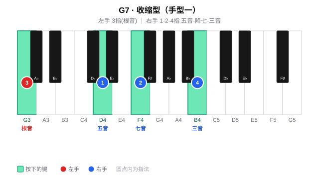
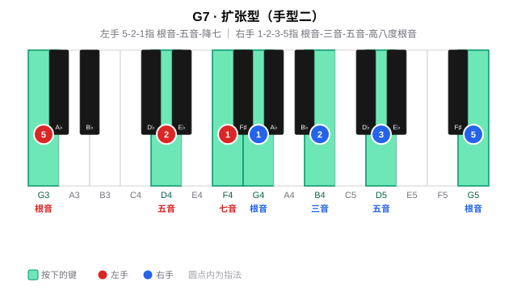
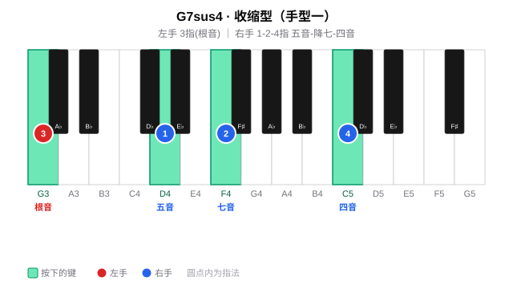
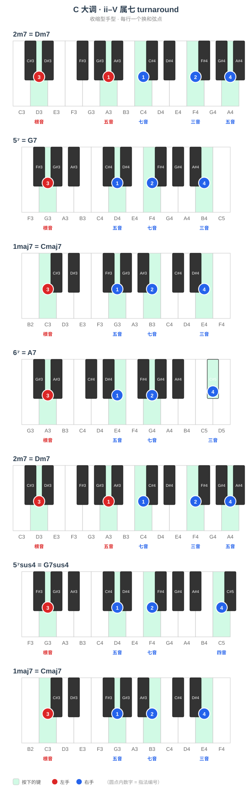
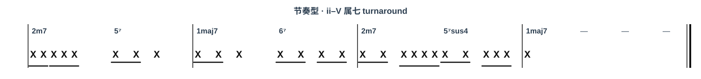

# 属七和弦

## 一、和弦结构

属七和弦（V7 / dom7）由**根音 + 大三度 + 纯五度 + 小七度**构成。

以 C7 为例：**C - E - G - B♭**

| 构成音 | 唱名 | 与根音的音程 |
|--------|------|------------|
| C | do | 根音 |
| E | mi | 大三度 |
| G | so | 纯五度 |
| B♭ | 降 xi | 小七度 |

> **功能**：在大调 **5 级** 最常用属七，小七度带来「要回 1 级」的推力。也可先用 **属七 sus4（V7sus4）**——把三音换成四音，再解决到 V7 或 I（见 [属七挂四](#属七挂四和弦-v7sus4)）。

---

## 二、手型与弹奏位置

### 手型一 · 收缩型

左手 **3 指** 弹根音（do），右手 **1-2-4 指** 弹五音、降七音、三音（so – 降 xi – mi）。与大七收缩型同构，只是七音为小七度。

| 声部 | 左手 | 右手 |
|------|------|------|
| 指法 | **3 指** 根音 | **1-2-4 指** 五音-降七-三音 |
| 示例（G7） | ③-G | ①-D、②-F、④-B |

### 手型二 · 扩张型

左手 **5-2-1 指** 根音-五音-降七音，右手 **1-2-3-5 指** 根音-三音-五音-高八度根音。

| 声部 | 左手 | 右手 |
|------|------|------|
| 指法 | **5-2-1 指** | **1-2-3-5 指** |
| 示例（G7） | ⑤-G、②-D、①-F | ①-G、②-B、③-D、⑤-G（高八度） |

---

## 属七挂四和弦（V7sus4）

**1 - 4 - 5 - ♭7**：在属七基础上**只把三音换成四音**（G7 → G7sus4：B 换成 C）。

- **收缩型**：左手 ③ 根音；右手 ① so、② 降 xi、④ **fa**（对应 G7sus4：D-F-C）。
- **扩张型**：左手 ⑤-②-① 根-五-降七；右手 ① do、② **fa**、③ so、⑤ 高八度 do。

---

## 三、和弦进行练习

**ii–V turnaround**（四小节、七个换和弦点）：

`2m7 → 5⁷ → 1maj7 → 6⁷ → 2m7 → 5⁷sus4 → 1maj7`

C 大调示例：**Dm7 → G7 → Cmaj7 → A7 → Dm7 → G7sus4 → Cmaj7**

在线练习入口：[每日练习 · 属七](../../../../practice/) · [进行 · ii–V turnaround](../../../../progressions/detail.html#id=dom7-turnaround)
